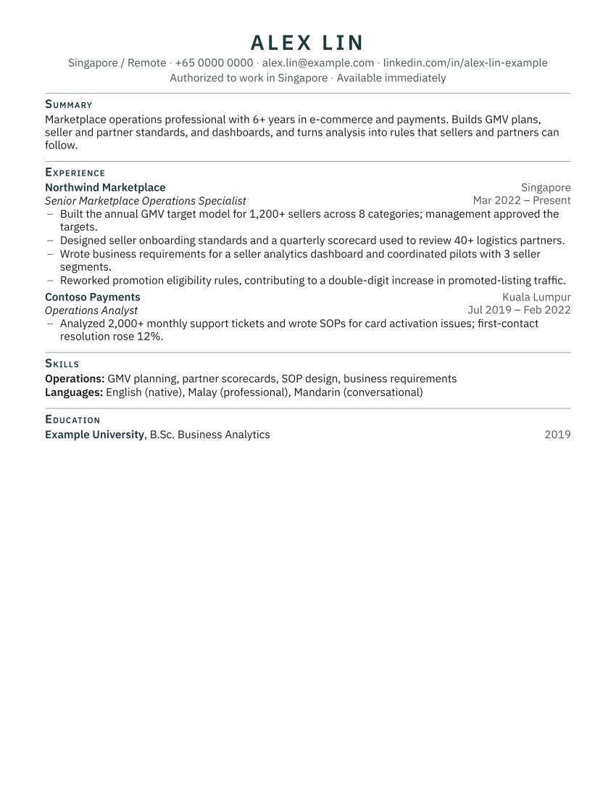

# job-search-skills

**English** · [中文](#中文)

Claude Code skills for running a high-volume job search without losing honesty: a daily search, a screening step, tailored one-page resumes and cover letters, recruiter outreach, and reusable form answers. Every document passes a fact check against the candidate's own confirmed facts before it ships, and the candidate approves and submits every application.



## What's inside

| Skill | What it does |
|---|---|
| [`job-pipeline`](skills/job-pipeline/SKILL.md) | Three linked workers (daily Searcher → Analyst → Materials) sharing one tracker, one facts file and one JD folder, with a status flow the candidate controls. Includes a tracker column spec, a Searcher prompt template and a `PIPELINE.md` template. |
| [`resume-builder`](skills/resume-builder/SKILL.md) | Builds one-page, ATS-safe PDF resumes and matching cover letters from JSON (single column, 11pt minimum, Letter or A4) with headless Chrome, and fails the build if a page overflows. |
| [`job-fact-check`](skills/job-fact-check/SKILL.md) | A script plus a review checklist: titles and dates must match the employment record, every number must exist in the facts file, and commonly inflated claims (people management, P&L, quota, negotiation…) are flagged. |
| [`job-outreach`](skills/job-outreach/SKILL.md) | Drafts a ≤300-character connection note, a ≤120-word message and a follow-up for the recruiter or hiring manager, from public information only. The candidate sends them. |
| [`job-form-answers`](skills/job-form-answers/SKILL.md) | Fills application-form questions from a confirmed answer bank, keeps employment history identical across applications, and asks instead of guessing. |

## How it works

```
Searcher (daily) ──New──▶ Analyst ──Screened──▶ Candidate ──Approved──▶ Materials ──Materials ready──▶ Candidate submits
                                                                              │
                                                     resume-builder · job-outreach · job-form-answers
                                                                              │
                                                                     job-fact-check (gate)
```

Design choices:
- **Facts file as the single source of truth.** AI tools tend to inflate. Every line traces to a dated fact the candidate confirmed, and the gate blocks anything that does not.
- **The human submits.** Workers never apply, sign in, or message anyone. Volume comes from preparation, not automation of the final click.
- **One tracker, column ownership.** Parallel workers each write only their own columns, so they never overwrite each other; formula columns flag duplicates by company + title or URL.
- **Measure replies, not applications.** The tracker reports response rate by role type, source and resume version, and the search mix shifts toward what gets answers.

## Install

As a Claude Code plugin:

```
/plugin marketplace add delmarstudios/job-search-skills
/plugin install job-search-skills@job-search-skills
```

Or copy the folders under `skills/` into `~/.claude/skills/`.

Requirements: Python 3, Google Chrome (for PDF output). A Google Sheets connector is optional, for the tracker.

## Set up your own data

1. `cp config/candidate.example.json config/candidate.json` and fill in your details (`config/candidate.json` is git-ignored).
2. Write your facts file (see [`examples/FACTS.example.md`](examples/FACTS.example.md)): dated, specific, including what you must **not** claim.
3. Start your answer bank from [`skills/job-form-answers/templates/form_answers.template.md`](skills/job-form-answers/templates/form_answers.template.md).
4. Copy [`skills/job-pipeline/templates/PIPELINE.template.md`](skills/job-pipeline/templates/PIPELINE.template.md) into your workspace and set your targets, location rule, pay floor and exclusions.

Try the example:

```bash
python3 skills/resume-builder/scripts/build_resume.py examples/resume.example.json /tmp/resume.html --config config/candidate.example.json
bash skills/resume-builder/scripts/render_pdf.sh /tmp/resume.html /tmp/Alex_Lin_Resume.pdf
python3 skills/job-fact-check/scripts/fact_check.py /tmp/resume.html --config config/candidate.example.json
```

All example people and companies are fictional.

## License

MIT © delmarstudios

---

## 中文

一套用于求职的 Claude Code skills：每日搜索岗位、筛选、定制一页简历和求职信、起草联络招聘方的消息、复用申请表答案。核心原则是**批量投递，但不夸大**：每份材料都必须对照候选人自己确认过的事实档案通过核查，每一份申请都由候选人本人确认并提交。

### 包含的 skill

| Skill | 作用 |
|---|---|
| `job-pipeline` | 三个环节接力：每日搜索 → 分析筛选 → 制作材料。共享一张申请记录表、一份事实档案和一个 JD 文件夹，状态流转由候选人把关。附带表格列设计、搜索任务模板和 `PIPELINE.md` 模板。 |
| `resume-builder` | 用 JSON 生成一页、对 ATS 友好的 PDF 简历和配套求职信（单栏、正文不小于 11pt、Letter 或 A4），超出一页即报错。 |
| `job-fact-check` | 脚本加人工核对：职位和日期必须与工作记录一致，所有数字必须能在事实档案中找到，并标出常见的夸大说法（管理下属、P&L、销售配额、谈判等）。 |
| `job-outreach` | 只用公开信息，为招聘方或用人经理起草 300 字符以内的好友请求、120 词以内的消息和跟进消息，由候选人自己发送。 |
| `job-form-answers` | 从已确认的答案库填写申请表，确保每份申请的工作经历表述完全一致；没有确认过的信息会先问，不会猜。 |

### 设计思路
- **事实档案是唯一依据。** AI 写材料容易夸大，所以每句话都要能追溯到候选人确认过、注明日期的事实，核查不通过就不能使用。
- **最后一步由人完成。** 各环节不会替你投递、登录或发消息。效率来自准备工作，而不是把点"提交"这一步也自动化。
- **一张表，按列分工。** 并行的各环节只改自己负责的列，互不覆盖；公式列按"公司 + 职位"或链接自动标出重复岗位。
- **看回复率，不只看投递数。** 按岗位类型、来源和简历版本统计回复率，并据此调整搜索方向。

### 安装与配置
安装方法、配置步骤和示例命令见上方英文部分。个人信息只放在被 git 忽略的 `config/candidate.json` 和你自己的事实档案里，不会上传。示例中的人物和公司都是虚构的。

### 许可
MIT © delmarstudios
